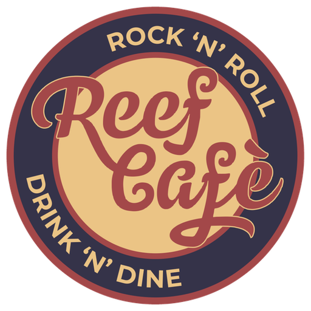
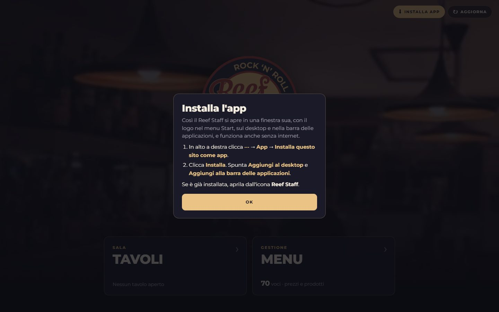

  

<h1 align="center">Reef Café · App Staff</h1>

  L'app della cassa del <b>Reef Café</b> (Borgo Santa Caterina 25, Bergamo), pensata per il <b>computer</b>: 
  <b>tavoli</b> con il conto che si calcola da solo e <b>pagamenti separati</b>, 
  e un <b>menu modificabile</b> (prezzi, prodotti nuovi, prodotti tolti) che si aggiorna su tutti i dispositivi.

  <a href="https://4kumiho.github.io/Reef/staff/"><b>👉 APRI L'APP 👈</b></a> 
  <code>https://4kumiho.github.io/Reef/staff/</code>

  

---

## 💻 Installa l'app sul computer (1 minuto, una volta sola)

Non servono account né programmi da scaricare. Dopo l'installazione il **Reef Staff** si apre in una finestra sua,
con il **logo Reef** nel menu Start, sul desktop e sulla barra delle applicazioni, e **funziona anche senza internet**.

### Il modo più semplice
1. Apri **[👉 Reef Staff](https://4kumiho.github.io/Reef/staff/)** con **Microsoft Edge** o **Google Chrome**.
2. Clicca il pulsante giallo **⬇ Installa app** in alto a destra.
3. Conferma con **Installa**. Fatto ✅

> Se cliccando **Installa app** compare una finestra con le istruzioni invece della conferma, segui quelle: dipende dal browser.

<b>Installarla a mano (se il pulsante non c'è)</b>

**Microsoft Edge** (già presente su ogni PC Windows)
1. Apri **[Reef Staff](https://4kumiho.github.io/Reef/staff/)**.
2. Menu **⋯** in alto a destra → **App** → **Installa questo sito come app**.
3. Clicca **Installa**. Nella finestra che segue spunta **Aggiungi al desktop** e **Aggiungi alla barra delle applicazioni**.

**Google Chrome**
1. Apri **[Reef Staff](https://4kumiho.github.io/Reef/staff/)**.
2. Nella barra dell'indirizzo, a destra, clicca l'icona **Installa** (uno schermo con una freccia).
   *Se non c'è:* menu **⋮** → **Trasmetti, salva e condividi** → **Installa pagina come app…**
3. Clicca **Installa**.

**Safari su Mac**: menu **File** → **Aggiungi al Dock** → **Aggiungi**.

*Firefox non installa le app: usa Edge o Chrome.*

> ⚠️ **Importante:** da quel momento apri l'app **sempre dall'icona Reef Staff**.
> I tavoli vengono salvati sul computer: se apri il sito da un altro browser vedi una memoria diversa (vuota).

💡 **Scorciatoie**: clic destro sull'icona nella barra delle applicazioni → **Tavoli** oppure **Menu** per andare dritto lì.

---

## 🍺 Come si usa

### 1. Pagina iniziale
Le foto del locale scorrono dietro il logo. Sotto ci sono i due riquadri: **Tavoli** (quanti sono aperti e quanto c'è da incassare) e **Menu**.

### 2. Arriva un tavolo → **+ Nuovo tavolo** (oppure il tasto **N**)
L'app propone già il primo nome libero (*Tavolo 1*, *Tavolo 2*…): premi **Invio** oppure scrivi il nome che vuoi (*Bancone*, *Esterno 2*…).

### 3. Segna cosa prendono
A destra c'è il menu diviso in gruppi: **Cocktail & Long drink**, **Birre**, **Vini & Bollicine**, **Shot, Amari & Distillati**,
**Analcolici & Caffè**, **Cucina & Stuzzicheria**, **Paninoteca**. Clicca un prodotto e si aggiunge all'ordine: **il totale si aggiorna da solo**.
Con **−** e **+** cambi le quantità.

**Il modo più veloce, con la tastiera:** appena apri un tavolo puoi già scrivere. Scrivi *aperol*, *media*, *nirvana*, *patatine*…
e premi **Invio** per aggiungere il primo risultato. Il tasto **/** riporta il cursore nella ricerca.

Per i **panini** si sceglie il formato: **Panino**, **Piadina** o **Focaccia**, ognuno col suo prezzo (anche con i tasti **1**, **2**, **3**).

Serve qualcosa che non è nel menu? **+ Voce libera** in fondo all'elenco: scrivi nome e prezzo.

### 4. Pagano separati → **Paga separato**
Seleziona cosa paga la persona alla cassa (con **+** e **−** su ogni riga). Vedi subito **quanto incassare** e **quanto resta**.
Premi **Incassa** e quelle voci spariscono dal tavolo. Ripeti per la persona successiva.

### 5. Pagano tutto → **Chiudi tavolo**
Ti mostra il totale da incassare e, confermando, elimina il tavolo.

### 6. Tutti i tavoli aperti
Dalla scheda **Tavoli** vedi tutti i tavoli con articoli, da quanto sono aperti e il totale.

### 7. Cambiare il menu (titolare / responsabile)
Dalla scheda **Menu** cambi tutto senza toccare il codice:

- **Cambiare un prezzo**: clicca la voce → scrivi il nuovo prezzo → **Salva**.
- **Aggiungere un prodotto**: **+ Nuova voce** → nome, prezzo, categoria (e se vuoi un'icona e gli ingredienti) → **Salva**.
- **Togliere un prodotto**: aprilo → **Elimina voce** (va cliccato due volte, per sicurezza).
- **Varianti**: le scelte che compaiono quando aggiungi la voce a un tavolo (gusti dello spritz, birra piccola/media,
  panino/piadina/focaccia…), ognuna con il suo prezzo.
- **Categorie**: rinominarle, riordinarle, aggiungerne di nuove.

  

  

#### 🔄 Le modifiche arrivano a tutti
Quando premi **Salva**, il nuovo menu viene pubblicato online. Gli altri dispositivi con l'app, entro un paio di minuti
(o appena riaprono l'app), mostrano in alto **«Il menu è stato aggiornato · Aggiorna»**: basta cliccare **Aggiorna**.

- I **tavoli già aperti** mantengono i prezzi con cui sono stati segnati; i nuovi ordini usano il menu nuovo.
- Per salvare serve **internet**.
- **Scarica copia** salva un file con tutto il menu (utile come backup).

#### 🔑 La chiave di pubblicazione (una volta sola, solo sul computer di chi cambia il menu)
Per poter **salvare** le modifiche, il computer deve avere la *chiave di pubblicazione*.
Senza chiave l'app si usa normalmente, ma il menu non si può cambiare (così nessuno lo modifica per sbaglio).

**Crea la chiave** (con l'account GitHub **4Kumiho**):
1. Apri questo link (molti campi sono già compilati): **[👉 Crea la chiave su GitHub](https://github.com/settings/personal-access-tokens/new?name=Reef%20menu&description=Chiave%20per%20modificare%20il%20menu%20dall%27app%20staff&target_name=4Kumiho&expires_in=366&contents=write)**
2. **Token name**: `Reef menu`.
3. **Expiration**: la durata più lunga disponibile (quando scade, basta crearne una nuova).
4. **Repository access**: **Only select repositories** → **4Kumiho/Reef**.
5. **Permissions** → **Repository permissions** → **Contents**: **Read and write**.
6. In fondo **Generate token**, poi **copia** la chiave (inizia con `github_pat_…`). ⚠️ GitHub la mostra una volta sola.

**Inseriscila nell'app**: scheda **Menu** → **Inserisci chiave** (o **Impostazioni**) → incolla → **Verifica e salva**.
Se è tutto giusto compare *«Chiave salvata»* e il pulsante diventa **Impostazioni ✓**.

> 🔒 Se il computer con la chiave viene perso o cambiato: su GitHub **Settings → Developer settings → Personal access tokens → Fine-grained tokens** ed elimina la chiave.

### ⌨️ Tasti utili
| Tasto | Cosa fa |
|---|---|
| **N** | Nuovo tavolo (dalla pagina iniziale o da Tavoli) |
| scrivi + **Invio** | Dentro un tavolo: cerca e aggiunge il primo risultato |
| **/** | Torna alla ricerca (in un tavolo o nel Menu) |
| **1** … **9** | Scegli la variante (formato del panino, gusto dello spritz…) |
| **Esc** | Chiude la finestra / svuota la ricerca |

---

## ❓ Domande frequenti

**Serve internet?**
Solo la prima volta e per ricevere gli aggiornamenti del menu. Poi funziona anche offline.

**Se chiudo l'app o spengo il computer perdo i tavoli?**
No, restano salvati sul computer.

**I tavoli si vedono su più computer?**
No: ogni computer ha i suoi tavoli. Usate un solo computer per segnare i tavoli (il menu invece è uguale per tutti).

**Ho cambiato il menu ma un altro dispositivo non lo vede.**
Deve essere collegato a internet: aprendo l'app compare **«Il menu è stato aggiornato · Aggiorna»**.
Se hai appena salvato, aspetta un paio di minuti: la pubblicazione online richiede 1–2 minuti.

**Esce «È disponibile una nuova versione dell'app».**
Clicca **Aggiorna** e si ricarica con le novità. Puoi anche controllare tu con **↻ Aggiorna** in alto a destra.

**I prezzi delle bevande sono giusti?**
I prezzi della **cucina**, della **stuzzicheria** e della **paninoteca** vengono dal menu cartaceo del locale.
Quelli delle **bevande** sono indicativi (il listino non è pubblicato online): controllali e correggili dalla scheda **Menu**.

---

## 🛠️ Per chi gestisce il progetto

| Cartella | Cosa contiene |
|---|---|
| `staff/` | L'app (pagina unica), service worker per l'offline, manifest e icone per l'installazione |
| `shared/menu.json` | **Il menu**: gruppi, categorie, voci, prezzi e varianti. Si modifica dall'app (sezione Menu) |
| `shared/config.js` | Nome del locale, logo, foto della pagina iniziale, repository dove pubblicare il menu |
| `shared/` | Logo, colori (`brand.css`), carattere, foto della pagina iniziale (`img/`) |
| `Foto/` | Logo originale, foto del menu cartaceo e del locale |
| `docs/screenshots/` | Le immagini di questo README |

- Il menu ufficiale è `shared/menu.json`. L'app lo modifica tramite l'API di GitHub (commit su `main`) con la chiave salvata sul
  computer; GitHub Pages lo rimette online in 1–2 minuti. Ogni dispositivo ne tiene una copia per l'offline e controlla ogni 2 minuti
  se il campo `versione` è più recente.
- Una categoria con `"scelta": true` (es. *Panini Rock*) mostra un bottone per voce che apre la scelta delle varianti;
  con `"tendina": true` ogni voce si apre a fisarmonica. I `gruppi` decidono l'ordine del menu a tendina dentro un tavolo.
- Le modifiche al codice arrivano ai dispositivi quando cambia `CACHE` in `staff/sw.js`.
- Provarla in locale: `python -m http.server 8000` nella cartella del progetto e apri http://localhost:8000/staff/
- Pubblicazione: **GitHub Pages** (Settings → Pages → Branch `main`, cartella `/ (root)`).
