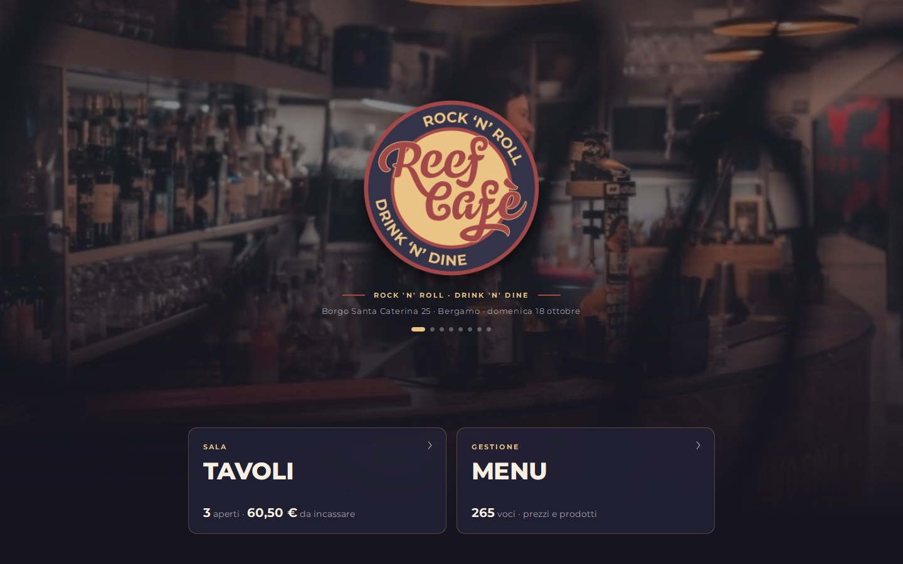
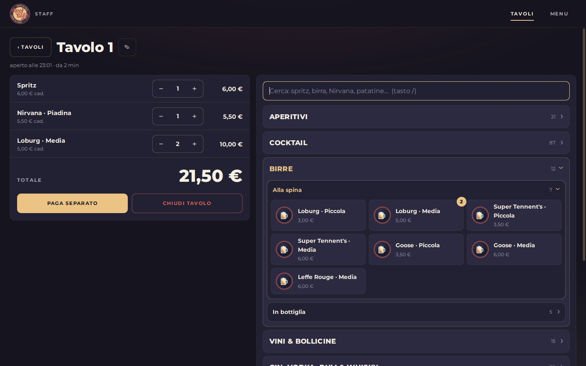
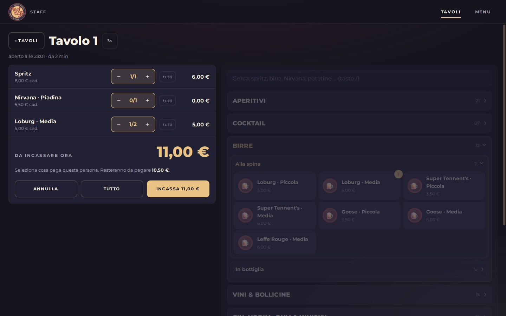
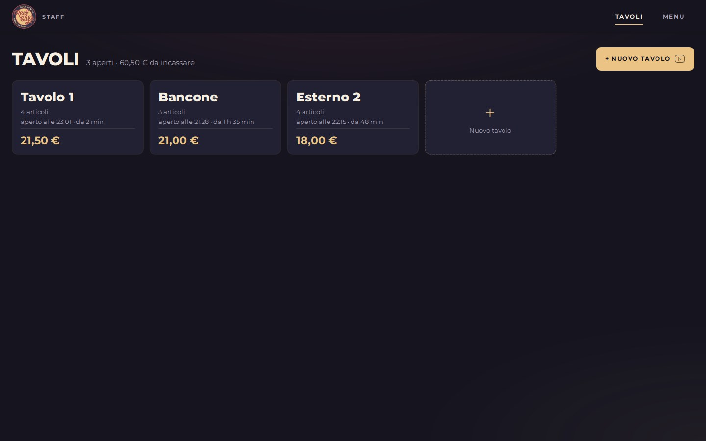
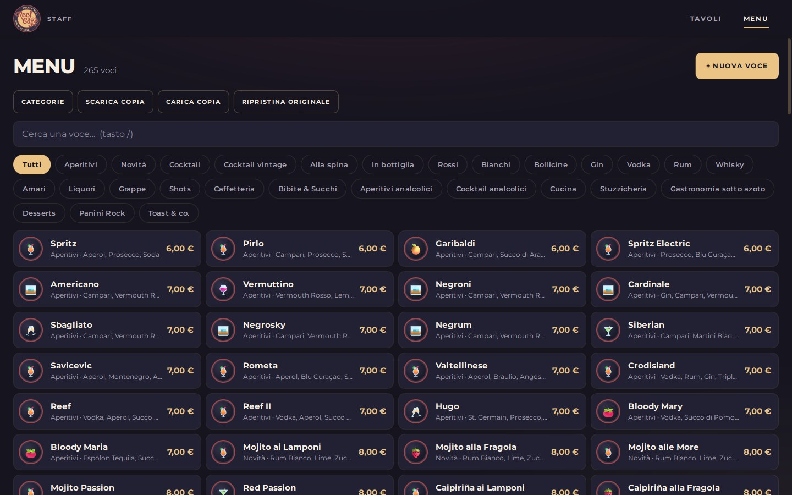
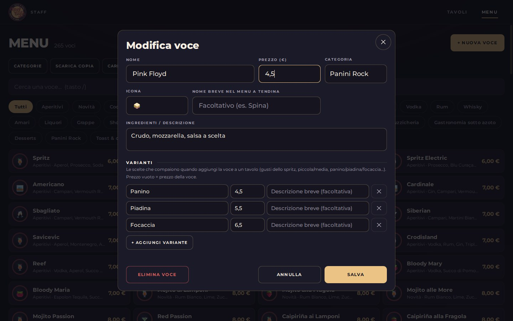

zzi di tutto quandto e 

  

<h1 align="center">Reef Café · App Staff</h1>

  Il programma della cassa del <b>Reef Café</b> (Borgo Santa Caterina 25, Bergamo), per il <b>computer</b>: 
  <b>tavoli</b> con il conto che si calcola da solo e <b>pagamenti separati</b>, 
  e un <b>menu modificabile</b> (prezzi, prodotti nuovi, prodotti tolti). 
  Funziona <b>senza internet</b> e tiene tutti i dati <b>sul computer</b>.

  

---

## 💻 Come si avvia (1 minuto, una volta sola)

Serve un computer con **Windows 10 o 11**. Non c'è niente da installare.

1. Scarica la cartella: in alto in questa pagina **Code** → **Download ZIP**.
2. Apri il file ZIP e trascina la cartella **Reef** dove vuoi tenerla, per esempio in **Documenti**. ⚠️ Non lasciarla dentro lo ZIP.
3. Nella cartella fai **doppio clic su `Reef Staff.exe`**. Fatto ✅

> **La prima volta Windows potrebbe mostrare «Windows ha protetto il PC».**
> È normale per i programmi scaricati da internet: clicca **Ulteriori informazioni** → **Esegui comunque**.
> Non lo chiederà più.

💡 **Icona sul desktop**: clic destro su `Reef Staff.exe` → **Mostra altre opzioni** → **Invia a** → **Desktop (crea collegamento)**.
Puoi anche trascinare l'icona sulla barra delle applicazioni.

L'app si apre a tutto schermo. All'avvio ci mette qualche secondo.

---

## 🗂️ Dove sono i dati

Tutto viene salvato **subito** in una cartella **`dati`**, accanto a `Reef Staff.exe`:

| File | Cosa contiene |
|---|---|
| `dati/tavoli.json` | I tavoli aperti con i loro ordini |
| `dati/menu.json` | Il menu con le modifiche fatte dall'app (compare dopo la prima modifica) |
| `dati/*.bak` | La copia precedente di ogni file, nel caso qualcosa vada storto |

- Se chiudi l'app o spegni il computer **non perdi niente**.
- **Non cancellare la cartella `dati`**. Per spostare l'app su un altro computer, copia **tutta** la cartella (exe + `dati`).
- Se la cartella non si può scrivere (per esempio dentro *Programmi*), i dati vanno in `%LOCALAPPDATA%\Reef Staff\dati`.

---

## 🍺 Come si usa

### 1. Pagina iniziale
Le foto del locale scorrono dietro il logo. Sotto ci sono i due riquadri: **Tavoli** (quanti sono aperti e quanto c'è da incassare) e **Menu**.

### 2. Arriva un tavolo → **+ Nuovo tavolo** (oppure il tasto **N**)
L'app propone già il primo nome libero (*Tavolo 1*, *Tavolo 2*…): premi **Invio** oppure scrivi il nome che vuoi (*Bancone*, *Esterno 2*…).

### 3. Segna cosa prendono
A destra c'è il menu diviso in gruppi come il menu cartaceo: **Aperitivi**, **Cocktail**, **Birre**, **Vini & Bollicine**,
**Gin, Vodka, Rum & Whisky**, **Amari, Liquori & Shot**, **Analcolici & Caffè**, **Cucina**, **Paninoteca**. Clicca un prodotto e si aggiunge all'ordine: **il totale si aggiorna da solo**.
Con **−** e **+** cambi le quantità.

**Il modo più veloce, con la tastiera:** appena apri un tavolo puoi già scrivere. Scrivi *spritz*, *loburg*, *nirvana*, *patatine*…
e premi **Invio** per aggiungere il primo risultato. Il tasto **/** riporta il cursore nella ricerca.

Per i **panini** si sceglie il formato: **Panino**, **Piadina** o **Focaccia**, ognuno col suo prezzo (anche con i tasti **1**, **2**, **3**).

Serve qualcosa che non è nel menu? **+ Voce libera** in fondo all'elenco: scrivi nome e prezzo.

### 4. Pagano separati → **Paga separato**
Seleziona cosa paga la persona alla cassa (con **+** e **−** su ogni riga). Vedi subito **quanto incassare** e **quanto resta**.
Premi **Incassa** e quelle voci spariscono dal tavolo. Ripeti per la persona successiva.

### 5. Pagano tutto → **Chiudi tavolo**
Ti mostra il totale da incassare e, confermando, elimina il tavolo.

### 6. Tutti i tavoli aperti
Dalla scheda **Tavoli** vedi tutti i tavoli con articoli, da quanto sono aperti e il totale.

### 7. Cambiare il menu (titolare / responsabile)
Dalla scheda **Menu** cambi tutto senza toccare il codice. Le modifiche si salvano **su questo computer** appena premi **Salva**.

- **Cambiare un prezzo**: clicca la voce → scrivi il nuovo prezzo → **Salva**.
- **Aggiungere un prodotto**: **+ Nuova voce** → nome, prezzo, categoria (e se vuoi un'icona e gli ingredienti) → **Salva**.
- **Togliere un prodotto**: aprilo → **Elimina voce** (va cliccato due volte, per sicurezza).
- **Varianti**: le scelte che compaiono quando aggiungi la voce a un tavolo (gusti dello spritz, birra piccola/media,
  panino/piadina/focaccia…), ognuna con il suo prezzo.
- **Categorie**: rinominarle, riordinarle, aggiungerne di nuove.
- **Scarica copia**: salva un file con tutto il menu (backup).
- **Carica copia**: rimette un menu salvato con *Scarica copia*.
- **Ripristina originale**: torna al menu di partenza.

I **tavoli già aperti** mantengono i prezzi con cui sono stati segnati; i nuovi ordini usano il menu nuovo.

  

  

### ⌨️ Tasti utili
| Tasto | Cosa fa |
|---|---|
| **N** | Nuovo tavolo (dalla pagina iniziale o da Tavoli) |
| scrivi + **Invio** | Dentro un tavolo: cerca e aggiunge il primo risultato |
| **/** | Torna alla ricerca (in un tavolo o nel Menu) |
| **1** … **9** | Scegli la variante (formato del panino, gusto dello spritz…) |
| **Esc** | Chiude la finestra / svuota la ricerca |

---

## ❓ Domande frequenti

**Serve internet?**
No, mai.

**Se chiudo l'app o spengo il computer perdo i tavoli?**
No, ogni modifica viene salvata subito nella cartella `dati`.

**Compare «Reef Staff è già aperto».**
L'app si può aprire una volta sola (due finestre si sovrascriverebbero i tavoli): cercala sulla barra delle applicazioni.

**Come aggiorno l'app a una versione nuova?**
Scarica di nuovo lo ZIP e sostituisci solo il file `Reef Staff.exe`. La cartella `dati` resta com'è: i tavoli aperti non si perdono.
Se la versione nuova porta un **menu nuovo**, questo prende il posto di quello modificato dall'app
(prima di aggiornare, se vuoi tenere le tue modifiche, fai **Menu → Scarica copia**).

**Da dove vengono voci e prezzi?**
Dal menu cartaceo del locale: aperitivi, cocktail, birre, vini, distillati, amari, analcolici, cucina e paninoteca.
L'**acqua** non è nel cartaceo: è stata lasciata a 1,50 €, controlla il prezzo.

---

## 🛠️ Per chi gestisce il progetto

L'app è scritta in **Python + Qt** (PySide6, interfaccia in QML) ed è impacchettata in un unico `Reef Staff.exe` con PyInstaller.

| Cartella / file | Cosa contiene |
|---|---|
| `Reef Staff.exe` | L'app pronta da usare (va ricreata dopo ogni modifica al codice) |
| `desktop/main.py` | Avvio della finestra, lettura e scrittura dei file in `dati/` |
| `desktop/qml/Main.qml` | Finestra principale: pagine, finestre di dialogo, avvisi, tasti |
| `desktop/qml/Reef/` | Interfaccia: `Store.qml` (dati e logica), `Theme.qml` (colori), una vista per pagina, i componenti |
| `desktop/assets/menu.json` | **Il menu di partenza** (gruppi, categorie, voci, prezzi, varianti) |
| `desktop/assets/img/` | Le foto del locale che scorrono nella pagina iniziale (l'elenco è in `Store.qml`, `bar.foto`) |
| `desktop/assets/` | Logo, icona, carattere Montserrat |
| `desktop/reef.spec`, `desktop/build.ps1` | Come si crea l'eseguibile |
| `docs/` | Le immagini di questo README |

- **Provarla dal codice**: `python desktop\main.py` (serve `pip install -r desktop\requirements.txt`).
  I dati finiscono in `dati/` nella radice della repo, che è esclusa da git.
- **Ricreare l'eseguibile**: da PowerShell, nella radice della repo, `.\desktop\build.ps1`.
  La prima volta crea l'ambiente Python in `..\.venv`. Poi fai il commit del nuovo `Reef Staff.exe`.
- Una categoria con `"scelta": true` (es. *Panini Rock*) mostra un bottone per voce che apre la scelta delle varianti;
  con `"tendina": true` ogni voce si apre a fisarmonica. I `gruppi` decidono l'ordine del menu a tendina dentro un tavolo.
- Se l'app dà problemi su un computer, guarda `dati/errori.log`.
